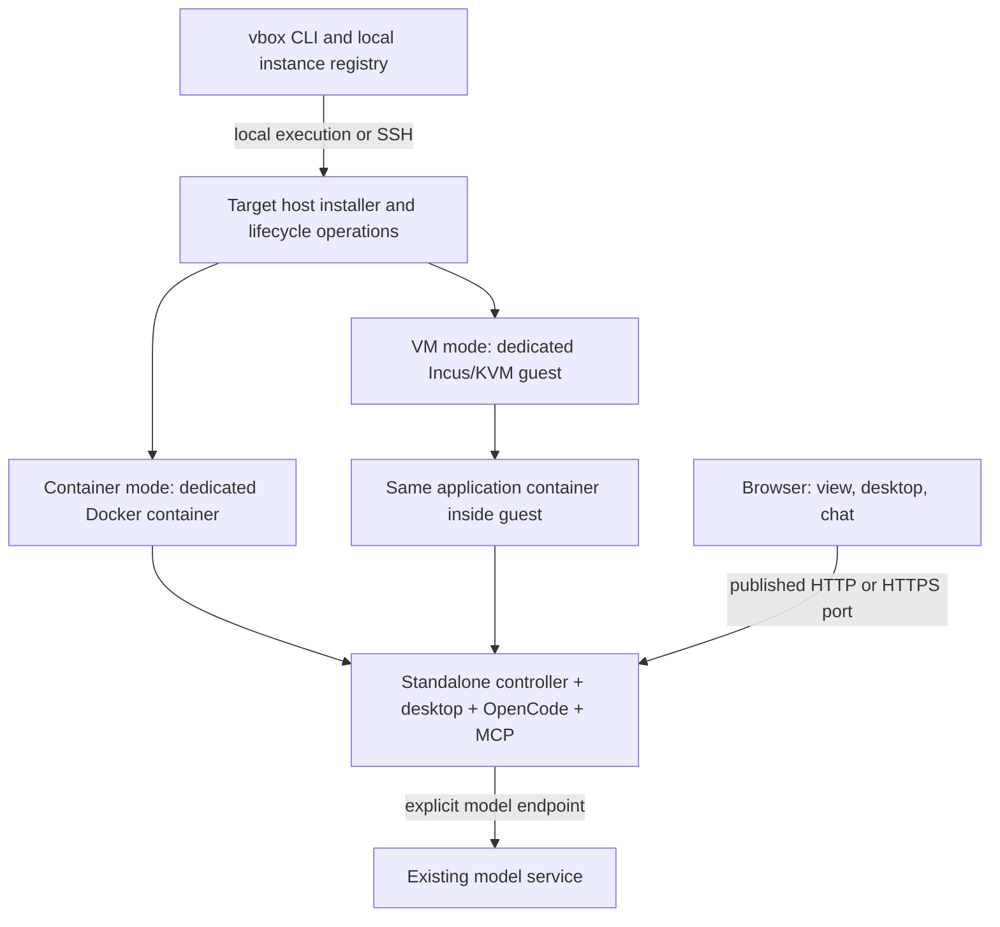

# Standalone vbox implementation plan

Status: proposed implementation contract. The commands and standalone behavior
below are planned, not currently available.

Implementation has started. See [current behavior and verification](STANDALONE.md)
for the supported experimental subset and outstanding work; this document remains
the complete target contract.

Build independently installable vbox instances, each containing a desktop,
OpenCode, the local vbox MCP tools, and a small standalone controller with a web
UI. The existing `vbox` CLI manages any number of these instances locally or over
SSH. Each instance has its own storage, conversation, credentials, resource
limits, network, and browser links. No central controller account is required.

Provide both Docker container mode and Incus/KVM VM mode. VM mode is the default
because the requested isolation includes a separate guest kernel. Both modes
run the same application image. The user supplies an existing model endpoint;
installation does not install Ollama, download model weights, or start inference.

Sections 1–14 define the product and lifecycle contract. Sections 15–20 turn
that contract into module boundaries, data/API contracts, work packages, and a
requirement-to-test map. Section 21 lists supporting references. Implementers
should work through the dependency order in section 19 rather than treating
this document as permission to add every subsystem in a single change.

## 1. Product contract

The first complete release must support all of the following:

- Interactive creation and editing through the existing `vbox` CLI, including
  its `vmbox` compatibility name.
- Installation on the local Linux host or a Linux homeserver reached through
  OpenSSH, including SSH config aliases.
- Multiple independent instances on one host and across several hosts.
- A wizard showing actual host resources and existing instance allocations
  before asking for CPU, RAM, storage, and access settings.
- A dedicated instance directory on the selected host.
- Selection of local OpenCode, Codex, and Claude profiles with visible source
  paths, following the existing `profiles upload` interaction.
- OpenCode as the default managed agent, configured for the selected model.
- An automatically started desktop and MCP service; opening a viewer is never
  necessary to make either ready.
- A standalone controller at a configurable port, with separate live view,
  interactive desktop, and normal chat links.
- Optional browser password, unset by default, with scoped capability links.
- CPU and RAM editing, verified effective settings, persistent files and chat,
  upgrades, backup, recovery, and deletion of explicitly selected resources.

The standalone controller manages exactly one instance. The CLI can manage many.
There is no automatic mesh, cross-instance chat, shared profile vault, task
scheduler, fleet allocator, mail service, or cloud fallback in this release.

OpenCode is the only required managed chat harness. Imported Codex and Claude
profiles remain their own formats. Selecting one may offer installation of its
CLI for terminal use, but does not change the managed agent. Bringing those CLIs
into the managed chat lifecycle is a later feature with its own verification.

## 2. Architecture and trust boundaries



The diagram shows the shared application design; every installed instance runs
its own copy. No component named `APP` is shared between instances.

### Host management

The host-side CLI path owns Docker/Incus operations, resource limits, port
allocation, installation state, upgrades, and disk lifecycle. Remote operations
execute over SSH. Host management credentials and sockets never enter the
workload. An agent cannot grant itself more RAM or change its host firewall.

The browser can report observed usage and display the CLI command for changing
host limits. Direct host resizing from the browser is outside the first release.

### Standalone controller

Add a dedicated executable, provisionally `vmbox-standalone`, and an
`internal/standalone` package. It serves real APIs and durable state rather than
mock responses. It owns one instance identity, one managed conversation, local
permissions, chat, attachments, browser authorization, and desktop transport.

Use SQLite for this small local store, with explicit schema versions and
transactional migrations. Keep its storage interface narrow. The current
controller Store opens PostgreSQL through pgx and has PostgreSQL-specific SQL;
changing its connection string is not a SQLite implementation. Reuse domain
types, runtime functions, API shapes, and selected web components without making
the entire fleet controller portable as a prerequisite.

### Runtime

Reuse the existing desktop, VNC capture/input, tmux session, OpenCode delivery,
MCP dispatch, and chat outbox code behind explicit standalone adapters. Give each
instance a durable UUID and each runtime launch a generation. Retain checks
against stale sessions and connections even though no fleet assignment exists.

Bind internal MCP HTTP, OpenCode bridges, and raw VNC to private sockets or
instance loopback. Publish only the standalone web gateway. Do not publish the
Docker daemon, Incus API, raw VNC, or the internal MCP bearer endpoint.

The agent and standalone service share a workload trust boundary. Host isolation
does not imply that an agent with arbitrary shell access cannot inspect its own
files, imported credentials, or conversation state. Imported credentials are
available to that instance by design.

## 3. CLI contract

Handle `standalone` before the existing controller connection/login requirement.
Use a separate instance registry; do not rewrite the saved fleet connection.
The new subcommand replaces neither `vbox new` nor ordinary fleet commands.

```bash
# Wizard on the local host; VM mode is the default.
vbox standalone create research

# Wizard on an SSH target, using ~/.ssh/config if present.
vbox standalone create coding --host home-server

# Explicit container mode with resource questions prefilled.
vbox standalone create browser --host user@192.168.1.20 \
  --mode container --cpus 2 --memory 4g --swap 1g

vbox standalone list
vbox standalone status coding
vbox standalone set coding
vbox standalone set coding --cpus 4 --memory 8g
vbox standalone links coding
vbox standalone open coding --view chat
vbox standalone profiles import coding
vbox standalone stop coding
vbox standalone start coding
vbox standalone logs coding
vbox standalone upgrade coding
vbox standalone backup coding --output ./coding-backup
vbox standalone restore ./coding-backup --name coding-restored --host home-server
vbox standalone delete coding
```

Use `--cpus` as the canonical flag and accept `--cpu` as an alias. Memory and
storage flags accept documented unit suffixes. Provide `--json` on inventory,
status, operation results, and links for automation. Sensitive URLs appear only
when explicitly requested, not in ordinary inventory or diagnostic logs.

`create NAME` and `set NAME` without configuration flags open the wizard/editor.
Partially supplied creation flags prefill fields and leave missing choices to
the wizard. A complete flag-based request can run noninteractively. Support
`--no-dialog` and `--yes` for explicitly configured automation; they do not
invent a model, accept changed SSH keys, or consent to unspecified host changes.
Without a terminal, report the exact missing configuration instead of hanging.

Names are unique within a CLI registry. Store a durable UUID, resolved SSH target,
host directory, mode, and observed revision for each entry. A new machine can
use `vbox standalone discover --host home-server` to inspect owned host manifests
and register existing instances. Discovery must not adopt unlabeled containers
or VMs merely because their names look familiar.

## 4. Creation and editing wizard

### Target and preflight

Prompt for local or SSH target when unspecified. Show connection status, OS,
architecture, CPU model and logical count, current load, RAM total and available,
swap, and free disk on the proposed storage filesystem. Also show Docker/Incus
availability, KVM usability, privilege requirements, available ports, and other
standalone instances on this host.

Example only; numbers below are not a measurement of a real host:

```text
Target       home-server / user@192.168.1.20
CPU          12 logical CPUs       load average 1.2 / 1.0 / 0.8
RAM          64 GiB total          43 GiB available
Storage      /srv                  720 GiB free
Virtualization  KVM available      Incus ready
Instances    research: 4 vCPU, 8 GiB RAM, running
             browser:  2 CPU limit, 4 GiB RAM, stopped
```

Distinguish configured allocations from current usage. CPU limits are not
reserved cores, and available memory is not a promise about future load. Inspect
the actual Docker/Incus host rather than the CLI laptop. If Docker itself lives
inside another VM, report that engine's effective capacity.

### Settings sequence

1. Choose isolation: VM by default, container by explicit selection. Explain the
   different kernel boundaries. If KVM cannot run, require a choice; never
   silently substitute container mode.
2. Choose host directory, storage pool when applicable, CPU, RAM, swap, and VM
   disk size. Display updated remaining headroom as settings change.
3. Select local profiles, with source paths and file preview. Allow a manual
   path and a skip option. Select at most one active profile per application;
   additional imported profiles remain named, inactive entries.
4. Configure the OpenCode provider/model, optional credential, and desktop
   resolution. Offer 1024x640 and 1280x720 initially.
5. Choose listening address, host port, optional public base URL, and optional
   password. Suggest a free port starting at 8080 and show its reachability scope.
6. Show the intended directory, instance resources, imported file names, host
   dependencies to install, network exceptions, and published address. Final
   confirmation starts installation.

Validate filesystem permission and free space before downloading large images.
Recheck port allocation and host resources immediately before creating resources.
Use a host lock to serialize registry and port reservations; a final bind failure
must still be handled because unrelated applications can occupy a port.

`set NAME` shows desired limits, actual engine limits, live usage, and host
capacity. Unchanged fields retain their values. When recreation or reboot is
required, show that consequence before executing it.

## 5. Storage, identity, and multiple instances

Propose `~/vbox-standalone/NAME` for the selected target login, with an editable
path such as `/srv/vbox-standalone/NAME`. Never silently take over a nonempty
directory without a matching manifest and instance UUID.

```text
NAME/
  instance.json        # UUID, schema, mode, engine IDs, desired configuration
  operations/          # resumable host operation journal, no credential payloads
  logs/                # bounded installation and lifecycle logs
  exports/             # explicit backups/exports
  data/                # container mode only; persistent application data
```

For VM mode, `instance.json` records the Incus project, storage pool, virtual disk
identifiers, and configured capacity. Incus owns the disk backing files. The
host directory is not exposed as a guest workspace. Guest `/data` contains the
home, project workspace, standalone database, attachments, and private runtime
state on that VM's disk.

Every mode gets independent secrets, browser link scopes, runtime sockets,
network identity, and log paths. Container networks and VM networks are assigned
per instance. There is no shared writable home or profile directory. Each
controller listens on the same internal port if convenient; host port mappings
or distinct domain names identify the instance externally.

Treat the host manifest and engine-owned resource labels as lifecycle evidence;
the laptop registry is a locator cache. Lock operations per instance and use
revision checks so two CLI clients cannot resize or upgrade it concurrently.
After interruption, reconcile actual engine state before resuming an operation.

## 6. Isolation and networking

| Property | Container mode | VM mode |
| --- | --- | --- |
| Kernel | Shared with Docker host | Dedicated guest kernel |
| Persistent storage | Dedicated directory/volume | Incus virtual disk |
| CPU/RAM enforcement | Docker cgroups | Guest allocation plus application limits |
| Management access in workload | No host sockets or SSH identity | No host sockets, directories, or SSH identity |
| Network | Dedicated Docker network with host-enforced rules | Private guest network with host-enforced rules |
| Default choice | Explicit opt-in | Default when requirements pass |

Start with Linux amd64 hosts. Detect arm64 and reject unsupported release
artifacts before making changes. Add arm64 only after publishing and testing
the application and guest image combination. A Windows CLI can target a Linux
host through SSH after packaging and profile-discovery tests; native Windows
containers are not part of this plan.

The agent does not need host privileges. Build required tools into the image;
optional CLI installation is an installer operation. Do not inherit the current
worker image's unrestricted sudo configuration without review. Run the agent
unprivileged, avoid privileged containers and host namespaces, and keep Docker
seccomp/AppArmor protections where supported. Any additional capability must
have a demonstrated requirement. Chromium sandbox behavior must be explicitly
tested for each mode rather than inherited from the fleet image unchecked.

Default outbound policy permits ordinary Internet use while denying unrelated
host services, LAN/private networks, other instances, and metadata endpoints.
Allow only the chosen model service address/port and required DNS through these
restrictions. Apply equivalent IPv4 and IPv6 rules. Gateway and DNS exceptions
must not accidentally grant every service on the gateway host. Validate any
resolved model address and update explicit rules when it changes.

Enforce network restrictions outside the agent workload. Rules must survive
host restart and be tested with Docker/Incus firewall behavior. If a platform
cannot enforce the promised policy, report the unsupported configuration rather
than marking isolation healthy. Rootless Docker requires separate verification
before being added to the supported matrix.

Only the web gateway is forwarded into the instance. LAN or public availability
depends on host routing/firewall and, for Internet service, a configured HTTPS
reverse proxy. Do not create router mappings or public tunnels automatically.
Offer an SSH tunnel when only SSH access is available. Such a tunnel is usable
by the client running it, not a globally shareable public URL.

## 7. Standalone controller and local persistence

Use a separate composition root from the fleet server. Define narrow interfaces
for instance identity, session control, tool policy, message persistence, blob
storage, and desktop streaming. Extract shared functionality where necessary
without replacing the fleet Store or sprinkling standalone conditionals through
all fleet handlers.

Proposed SQLite records include instance settings, tool permissions, conversation
identity, messages, delivery receipts, tool events, pending questions,
attachments, browser sessions/capabilities, and schema migrations. Use transactions,
bounded retention for operational events, a busy timeout, and a tested backup
method. A raw copy of a live WAL database is not an acceptable backup.

Keep proposed owner APIs under a versioned standalone namespace such as
`/v1/standalone`, with status, chat/history, message submission, event streaming,
session interruption, and desktop transport. Preserve the existing
`/v1/agent-desktop` shapes only for the subset the runtime actually needs, such
as tool-policy and readiness callbacks. Document exact route compatibility in a
contract table during the first milestone; do not fabricate fleet inventory to
make the old full UI believe a fleet exists.

The existing agent client validates HTTPS controller endpoints. Add an explicit
standalone transport using a private Unix socket or authenticated loopback
connection. Do not relax the HTTPS validation for normal fleet deployments.
Browser capabilities must never authorize this internal agent API.

## 8. Desktop, chat, and MCP behavior

The startup sequence creates local identity and generation, opens storage,
starts the desktop and window manager, starts private MCP services, launches the
managed OpenCode session, and verifies bridge readiness. The web gateway can
display progress throughout. A model error should leave a usable desktop and an
actionable chat error instead of a permanently spinning startup screen.

Use explicit states: stopped, starting, ready, degraded, stopping, and failed,
with component details. Distinguish model warming/unavailable from a broken
desktop or a dead OpenCode bridge. Bounded retry and component-level recovery
must not repeatedly restart a healthy desktop or duplicate a conversation.

### Chat delivery

1. Persist the user's message and stable request ID before acknowledging it.
2. Deliver it to the existing OpenCode conversation through its structured
   bridge, not terminal paste. Retrying uses the same ID.
3. Track queued, accepted, uncertain, failed, and answered separately. A timeout
   alone does not prove delivery failed and must not trigger a duplicate prompt.
4. Persist `chat_message` and `chat_ask` events idempotently before acknowledging
   or deleting their runtime outbox entries.
5. Stream persisted changes to the browser with resumable event cursors. A
   reconnect reloads history and continues the same agent session.

Use vbox MCP replies as the initial owner-facing assistant transcript, matching
the existing chat contract. Native OpenCode output supplies activity/readiness;
do not also render it as a second copy of each reply. Include attachments,
choice questions, and interruption. Detect a completed native turn without an
owner reply and surface it rather than pretending an answer was delivered.

Preserve OpenCode's conversation ID across normal restarts. Verify that restoring
selects that conversation. If restoration cannot be verified, show an explicit
restore error with an option to start fresh; never silently reset context.

### MCP scope

Required tools are `take_screenshot`, `capture_window`, mouse movement/click/
drag/scroll, text/key input, `chat_message`, `chat_ask`, and local `heartbeat`.
Keep screenshot cursor headers and coordinate behavior identical to fleet boxes.
Publish local tools according to standalone permissions and reject disabled calls
at dispatch, not only in the discovery list. Desktop input shares the existing
input lock and human takeover/pause behavior.

Remove contacts, fleet and task creation, other-box control, controller mail,
run budgets, and controller secret-vault operations from the initial tool list.
Adjust tool descriptions, registration instructions, generated guidance, and
background activity/reporting loops so none expect fleet callbacks. Local
ordinary chat must not require the agent to know a controller token.

Expose the instance links in local runtime metadata and a small local MCP tool
such as `get_instance_links`, with an explicit requested scope. Store capabilities
privately and avoid embedding them in general MCP instructions. Returning a
control/chat link deliberately grants that capability; it must not contain a
configured password. The agent can share a view link through its chat when asked.

## 9. Browser views and access

Serve one instance landing page with links to `/view`, `/desktop`, and `/chat`.
Reuse desktop rendering and suitable chat UI components in a small standalone
shell. Omit fleet navigation and unavailable controls rather than showing a
broken multi-box application.

| Link scope | Allowed behavior |
| --- | --- |
| View | Live desktop frames only; no keyboard, mouse, clipboard transfer, chat, files, or settings |
| Desktop | Desktop interaction and the necessary clipboard/takeover operations |
| Chat | Read/send messages, answer questions, access chat attachments, interrupt the agent |

Host administration remains through the CLI. Any owner-only UI settings need a
distinct administration grant; view/control/chat links do not implicitly confer
it. Chat is an active capability because the user can ask the agent to act.

Create independent cryptographically random capabilities for each scope.
Password is unset by default. When configured, require both the capability and
password to establish a browser session. Support scope rotation/revocation and
invalidate associated live streams. Store password hashes, not recoverable
password values, and accept passwords by masked prompt or private input rather
than ordinary command arguments.

Exchange link secrets for scoped sessions without leaving secrets in access
logs, Referer headers, or routine diagnostics; a URL fragment/bootstrap exchange
is one candidate. For multiple instances on the same hostname with different
ports, remember that cookies are not port-isolated. Use an origin-scoped bearer
session design with one-use WebSocket tickets, or require distinct hostnames for
a cookie design. Bind all grants to the instance UUID and scope. Reject cross-
origin API/WS requests and tokens minted by another instance.

Enforce read-only viewing on the server with the existing RFB input filter.
Also suppress clipboard/file transfer extensions in both directions. A user
changing `viewOnly` in browser JavaScript must still be unable to send input.
Check attachment/history/settings authorization independently of page access.

Bundle the UI and dependencies with the release so local usage does not depend
on a third-party web UI CDN. HTTPS terminates at a configured gateway/proxy for
public access; localhost or trusted LAN HTTP can be selected explicitly.

## 10. Profile import and model setup

Extract discovery and profile selection from `profiles upload` so both flows can
reuse it without its initial controller API calls. Discover on the CLI machine;
label source paths as local when installing to a remote server. Offer a manual
path and display selected filenames, application, profile name, and destination.

Use a bounded file allowlist, validate file types and paths, reject unsafe
symlinks/traversal, and transfer bytes over SSH or private local stdin. Preserve
original host files. Do not mount the host home or send credentials in argv,
build layers, manifests, logs, or URLs. Imports use private file permissions and
explicit replacement behavior. Clear temporary transfer material on completion
or failure.

Preserve supported imported settings while adding the standalone vbox MCP
registration. Handle OpenCode JSON and JSONC deliberately; current registration
rejects an existing JSONC configuration. Implement a tested configuration overlay
or parser before claiming JSONC import works. Detect host-only paths, external
plugins, MCP commands, and shell hooks; report what is portable and what needs
adjustment. Do not silently execute host-path hooks during discovery.

The explicit wizard model choice overrides an imported default. Credentials for
other providers may be imported but must not activate cloud fallback. Codex and
Claude credentials are not automatically convertible into OpenCode credentials.

Configure a pinned OpenCode version against the supplied model API. Test from
inside the final instance network, checking reachable endpoint, model identity,
streaming, tool calls, configured context limits, and images when desktop vision
is requested. Some compatible servers cannot enumerate models; permit an exact
manual model ID and verify it with a small probe. If vision is unsupported, show
that limitation; do not describe screenshot understanding as verified.

Host model endpoints bound only to host loopback need a deliberate forwarding
path or a service bound to the private instance-facing address. Mapping a hostname
to a host gateway does not by itself make a loopback-only service reachable.
Keep the model/network exception specific to its destination port.

## 11. Installation and lifecycle

The installer has one operation model for local and SSH transports. Its durable
journal records validated target, reserved identity/port, dependency status,
image digest, created storage/network/compute IDs, imported configuration,
readiness result, and registration. Journal records never contain profile bytes
or browser secrets.

Retries reuse the same UUID and operation ID. After an SSH disconnect, inspect
the host before retrying creation. A failed installation can be resumed or
cleaned up using verified ownership labels; neither path deletes unrelated host
resources. Prefer argv-based execution and structured stdin over interpolated
shell commands. Respect SSH config, known_hosts, and agent authentication, and
never forward the SSH agent into the workload.

Only install missing Docker/Incus dependencies after presenting the concrete
host changes and obtaining the necessary sudo access. Do not reinitialize an
existing Incus installation or change other workloads' storage/network defaults.
Use a dedicated project and owned resources where supported. A passwordless
sudo assumption is not an installation strategy.

### Container mode

Create a dedicated network and persistent data area, apply CPU/RAM/swap and PID
limits, configure log rotation, and publish the selected gateway port. The
entrypoint uses a reaping init and supervises only this instance's processes.
Set an explicit host reboot policy. Closing a browser tab leaves the instance
running. The standalone image should omit unrelated heavyweight fleet tools.

### VM mode

Verify actual KVM access, not just CPU flags. Create an Incus VM from a pinned,
verified guest image, attach/configure its virtual disk, provision Docker inside
the guest, and start the same application image. The VM is the host isolation
boundary; Docker inside it provides common application packaging.

Allow guest OS and Docker overhead when deriving the inner container limits.
For example, an 8 GiB VM must not promise the application all 8 GiB. Show guest
allocation and application limit separately. Initialize swap inside the guest
when selected. Private host-to-guest port forwarding exposes only the gateway.
Set guest and application startup policies so a host reboot restores both.

### Resource editing

For Docker, use live resource updates when supported and verify via inspection.
Define `--swap` as additional swap, translating to Docker's RAM-plus-swap setting.
Reject live memory reductions below observed usage rather than risking an
unexpected kill; offer a planned stop/reconfigure path. Keep unchanged limits.

For VMs, verify changes in both Incus and the guest. Hotplug support and guest
behavior determine whether a restart is necessary. VM CPU values are whole vCPU
counts; container CPU limits may be fractional. Coordinate inner limits in an
order that does not temporarily exceed a shrinking guest allocation.

VM disk growth includes guest partition/filesystem expansion and verification.
Do not offer disk shrink. Container disk size is host capacity unless an actual
supported quota mechanism is installed and verified; do not store a decorative
disk limit in metadata and present it as enforced.

Persist desired configuration with operation state, but do not mark it applied
until verified. If one part of an edit succeeds and another fails, show desired
and observed values and provide deterministic retry/reconciliation.

### Upgrade, backup, and deletion

Pin application and guest releases by digest and record the deployed versions.
An application upgrade reuses persistent storage. Quiesce the conversation and
state writes, make a consistent database/config backup, run migrations, and
verify desktop, MCP, and chat readiness. An incompatible migration requires a
documented restore path; simply starting an older image against a new schema is
not rollback.

Backups include the instance manifest, workspace/home, chat database, attachments,
profile state, and required private keys, with restrictive access. Restore to a
new UUID and new access capabilities by default; original and restored instances
must not share browser tokens or collide on ports. Test recovery on a fresh host.

Define stop as graceful process shutdown retaining data; restarting resumes the
stored conversation where verified. Deletion confirms the exact instance and
data consequence, then checks resource UUID/ownership before removal. Never use
global prune or delete a shared storage pool. Keep automated upgrade backups
until the new release passes readiness, and apply a documented retention policy
after success.

## 12. Existing code and proposed additions

| Area | Existing entry points | Planned change |
| --- | --- | --- |
| CLI dispatch | `internal/cli/cli.go` | Route standalone before controller login; preserve fleet behavior |
| Forms and profiles | `internal/cli/profile_upload.go`, `internal/cli/creation.go`, `internal/components/components.go` | Reuse discovery/forms through a local import destination |
| Engine operations | `internal/provider/docker/provider.go`, `internal/provider/incus/provider.go` | Reuse audited create/inspect/resize pieces; add standalone ownership, ports, journaling and VM provisioning |
| Runtime startup | `internal/boxruntime/interactive.go`, `desktop_terminal.go`, `desktop.go` | Explicit local identity and automatic startup |
| OpenCode/chat | `internal/boxruntime/opencode_tui.go`, `chat.go`, `opencode_resume.go` | Local delivery, durable receipts, verified restore |
| MCP | `internal/boxruntime/desktop_mcp.go`, `desktop_mcp_http.go`, `desktop_agent_client.go`, `agent_tools.go` | Standalone policy/transport/callback adapters and scoped links |
| Desktop UI/stream | `internal/controller/web/workspace-desktop.js`, `internal/controller/web_terminal.go`, `internal/desktop/view_only.go` | Extract reusable viewer and protocol protection |
| Image | `Dockerfile`, `scripts/worker-entrypoint.sh` | Add standalone image/entrypoint with required components and reviewed privileges |
| New local service | `cmd/vmbox-standalone`, `internal/standalone` | One-instance HTTP service, SQLite store, local adapters |
| New management | `internal/cli/standalone*.go`, a standalone host-management package | Registry, wizard, local/SSH transport and lifecycle operations |

The Docker/Incus adapters are implementation starting points, not evidence that
the proposed installation paths already pass lifecycle or isolation tests. In
particular, review the existing Incus filesystem-volume attachment approach
against the VM-owned disk contract before reuse.

## 13. Delivery milestones and review gates

### Milestone 1 — Contract and foundations

Add the standalone command namespace, registry schema, instance manifest,
operation journal, transport interfaces, API compatibility table, and readiness
model. Add pure host probes and a wizard preview without creating a workload.
Prove standalone commands work with no fleet connection and cannot alter it.

### Milestone 2 — Working standalone runtime

Build the application image and local controller. Implement desktop startup,
local tool policy, OpenCode chat delivery, durable replies/questions, SQLite
history, and the three browser scopes. Run the full loop in a disposable local
container: user message, agent desktop tool, screenshot, response, and reconnect.

### Milestone 3 — Local container product

Complete creation/editing forms, profile transfer, model verification, resource
limits, link management, storage, isolation rules, and local lifecycle commands.
Run two instances simultaneously and prove independent chats, credentials,
networks, ports, and resource changes.

### Milestone 4 — SSH installation and recovery

Run the same operation model against an isolated remote Linux test host. Verify
dependency setup, source-path labeling, secure profile transfer, reconnect after
interrupted installation, host discovery from a fresh CLI, and multiple hosts.
The client must not require a local Docker daemon for remote operations.

### Milestone 5 — VM installation

Implement guest provisioning, VM storage, guest/container resource coordination,
network forwarding, KVM preflight, disk growth, and startup after host reboot.
Test one local VM, one SSH-installed VM, and at least two concurrent VMs on one
host. Unsupported KVM must fail before partial VM creation.

### Milestone 6 — Release lifecycle and documentation

Finish consistent backup/restore, application upgrade/rollback, credential/link
rotation, bounded logs, health diagnostics, and safe deletion. Publish tested
image artifacts and an install/operations guide. Update CLI help and the current
controller-first documentation to explain the new explicit standalone namespace.
Both container and VM paths must pass the release matrix before calling the
feature complete; intermediate milestones may be marked experimental.

## 14. Verification and acceptance matrix

Use isolated, clearly labeled disposable resources. Never borrow a production
worker or user volume for these tests. Cleanup uses the test instance UUIDs.

| Test | Required evidence |
| --- | --- |
| CLI and wizard | No controller login; flags prefill; missing noninteractive inputs fail; host numbers and paths refer to target |
| Local/SSH × container/VM | All four installation paths reach desktop, MCP, and chat readiness |
| Multiple instances | At least two on one host; separate storage, identities, links, ports, conversations and credentials |
| Startup | Desktop and MCP ready before any viewer connects; first prompt reaches exactly the visible conversation |
| Delivery recovery | Retry a message ID and interrupt/reconnect transport; one durable user message and no duplicate native prompt |
| View protection | Forged RFB keyboard/mouse/clipboard/file-transfer traffic rejected; view scope cannot use chat or settings APIs |
| Browser authorization | Cross-origin calls, cross-instance tokens and revoked sessions fail, including existing WebSockets |
| Profile import | Synthetic secrets stay out of logs/images; JSON/JSONC paths handled; originals untouched; overrides explicit |
| Model behavior | Existing local endpoint, text/tool streaming, missing model, slow warmup, unreachable endpoint, optional vision |
| Resource editing | Engine and guest agree; settings survive restart/recreation; unsafe shrink and partial changes reported |
| Isolation | Host files/sockets unavailable; sibling and unrelated LAN/metadata access denied; selected model route works |
| Persistence | Files, browser profile, history, and native conversation survive restart and successful upgrade |
| Backup/recovery | Restore on fresh host/new UUID; migrations and rollback tested; no shared capabilities |
| Failure cleanup | Interrupt each installer phase; resume without duplicates or delete only owned resources |

Run `go vet ./...`, `go test ./internal/...`, and the full serial browser suite
through `npm run test:browser`, plus focused standalone integration tests. Inspect
`scripts/check.sh` for current repository gates when implementing. Add real
OpenCode/browser smoke tests and actual Docker/KVM tests; mocks cannot establish
the isolation or startup claims. Track pre-existing environment failures
explicitly rather than silently treating an incomplete run as a pass.

Measure component startup times, time to the first desktop frame, prompt receipt,
and native response start separately. Record cold image pull and model warmup
separately from warm instance startup. Use those measurements to set release
performance thresholds; do not attribute model inference latency to the desktop
connection. A readiness timeout must identify the component and leave actionable
logs rather than an indefinite starting indicator.

## 15. Required module reuse

Shared behavior must have one implementation used by fleet and standalone.
Adapters may change transport, authorization, persistence, and provisioning;
they must not fork the desktop engine, input semantics, OpenCode bridge, or
message-receipt protocol. Existing fleet behavior remains the regression baseline
when extracting these modules.

### Runtime boundary

Retain these implementations in `internal/boxruntime` and `internal/desktop`:

| Existing symbol or area | Reuse requirement |
| --- | --- |
| `StartDesktop`, `RunDesktop`, `StreamDesktop` | Use the existing desktop session and VNC socket lifecycle |
| `DesktopInput` and capture implementations | Preserve coordinates, cursor headers, validation, takeover, and serialization |
| `StartInteractive` and managed restoration | Start one managed session and restore it through the existing harness machinery |
| `DeliverOpenCodeChat`, `ConfirmOpenCodeChat` | Preserve native receipt identity and reconcile ambiguous submission |
| `PullChatEvent`, `AckChatEvent` | Drain the existing outbox and acknowledge only after durable local persistence |
| `allowedDesktopMCPTools`, MCP dispatch | Inject local policy/backend behavior; retain tool schemas and dispatch checks |
| `FilterViewOnlyRFB` | Share protocol filtering; add missing extension protections in the shared layer |

Introduce the smallest backend interfaces needed for tool-policy lookup,
readiness notification, activity reporting, and link retrieval. Select a fleet
or standalone backend explicitly when constructing the runtime service. Do not
use the absence of a token as permission to select unrestricted standalone mode.
Do not add a second desktop implementation under `internal/standalone`.

The runtime must not import the standalone controller package. Shared request
and response types belong in existing common packages or a small neutral package;
standalone constructs the adapters. Avoid process-wide mutable backend globals
that could cross-contaminate tests or different instances in one process.

Audit every background callback before enabling the local backend: tool policy,
chat-ready, tool activity, busy state, mascot observation, and followups. A
callback must be implemented locally, translated into supported local state, or
explicitly disabled in standalone construction. An HTTP 200 from a no-op handler
is not evidence that the underlying feature works.

### UI and profile boundaries

Extract the existing desktop viewer, Markdown/message rendering, attachment
presentation, question choices, and input composer into reusable components as
needed. Keep full fleet inventory/navigation in the fleet shell and mount those
components in a one-instance standalone shell. Inject the API client instead
of embedding fleet endpoint URLs in shared components.

Shared browser assets should be embedded once through a common asset package or
build entry point. A copied `chat.js` with separate fixes is not acceptable reuse.
Use existing CSS/tokens where practical, with a small standalone layout layer.
Keep all required assets local to the release bundle.

Extract profile discovery and the marked-row picker from
`uploadProfilesDialog`; the current function begins by fetching saved controller
profiles. Define separate destinations for controller upload and local instance
import. Both call the same bounded profile reader and validation logic. Tests
must prove that standalone discovery makes no controller HTTP requests.

### Provisioning boundary

Keep Docker and Incus command generation in shared provider/engine helpers where
their semantics match. Add operation-specific helpers for ports, networks,
guest provisioning, and resource inspection. Do not build a second set of shell
strings for existing inspect/start/stop/resize actions in the CLI.

The current Docker resize path sets memory-plus-swap equal to memory, effectively
disabling swap during that update. Standalone's separate swap setting requires
an explicit update contract; preserve existing fleet defaults unless its callers
opt into the extended semantics. The Incus adapter currently attaches a custom
filesystem volume; VM-owned virtual disk provisioning needs its own verified
storage operation rather than assuming that attachment meets the new contract.

### What is deliberately new

SQLite repositories, standalone authentication, host manifests/journaling,
multi-host CLI inventory, guest provisioning, and the standalone composition
root have no drop-in implementation in the current fleet controller. Build these
around shared runtime primitives. Do not port the full PostgreSQL schema or
simulate accounts/providers simply to reuse a handler that depends on them.

## 16. Proposed package and interface structure

The following paths are proposed additions, not existing modules:

```text
cmd/vmbox-standalone/main.go           runtime service composition
internal/standalone/
  server.go                          routes, scoped authorization, shutdown
  store.go + migrations/             SQLite schema and repositories
  runtime.go                         adapter to existing boxruntime functions
  chat.go                            durable delivery/outbox reconciliation
  desktop.go                         scoped WebSocket to shared desktop stream
  auth.go                            capabilities, passwords, scoped sessions
  health.go                          component state and diagnostics
internal/standalonehost/
  manifest.go + registry.go           host records, ownership, revisions
  transport.go + ssh.go               structured local/SSH execution
  operations.go                      resumable lifecycle and locks
  probe.go                           capacity and platform checks
  container.go + vm.go                orchestration around shared engines
  resources.go + backup.go            verified resize and restore workflows
internal/cli/standalone*.go            dispatch, forms, output and confirmations
```

Expose narrow interfaces rather than a universal service with every operation:

| Boundary | Required operations | Owner |
| --- | --- | --- |
| Runtime session | Ensure, observe, deliver, confirm, interrupt, restore | Existing runtime plus thin standalone adapter |
| Chat repository | Insert idempotently, list by cursor, record receipt, commit outbox event | SQLite implementation |
| Tool backend | Read permissions, signal durable event, report activity, retrieve scoped links | Fleet or standalone adapter |
| Host transport | Execute argv/structured request, stream private input, transfer bounded files | Local or OpenSSH transport |
| Installation driver | Probe, plan, apply, inspect, resize, stop/start, export, destroy-owned | Docker or Incus VM implementation |

Never pass a Docker/Incus lifecycle driver into the guest controller. The
standalone service should not depend on `internal/standalonehost`. Process
execution inside the guest uses the guest runtime; host execution stays in the
management package.

Use the same operation planner for CLI previews and execution. A plan contains
typed steps, resource ownership IDs, preconditions, restart consequences, and
recovery actions. It must not contain a shell script assembled from raw user
input or plaintext credentials.

## 17. Data, API, and operation contracts

### Durable identity and configuration

Store the laptop registry under the CLI configuration area in a separate
`standalone.json`; keep host manifests in the selected instance directory. Store
secret material separately with restrictive permissions. Model credentials and
profile contents do not appear in the following manifest fields:

| Field | Purpose |
| --- | --- |
| `schemaVersion`, `revision` | Parse and update the manifest safely |
| `instanceId`, `name`, `mode` | Stable identity independent of display name |
| `engineRefs` | Exact container/VM/network/disk identifiers and ownership labels |
| `resources.desired`, `resources.observed` | Requested limits versus last verified effective values |
| `storage` | Host manifest path, data path or VM storage references |
| `image` | Application digest, guest fingerprint when applicable, schema compatibility |
| `access` | Bind address, published port, public base URL, authentication mode |
| `model` | Provider, model ID, endpoint, credential reference, verified capabilities |
| `managedSession` | Harness and durable native conversation reference |
| `operation` | In-progress operation ID, phase, revision and reconciliation status |

The guest need not see host management paths or credentials. Pass only the
sanitized instance configuration it needs. Generate a new runtime generation
on boot without replacing the durable instance or native conversation ID.

### SQLite invariants

Use separate logical records for message text, delivery state, native receipts,
questions, and attachment references. Suggested uniqueness rules are:

- One message per `(conversation_id, client_request_id)`.
- One imported runtime event per `(instance_id, event_id)`.
- One recorded answer per `(question_id, answer_request_id)`; a repeated
  request cannot deliver the answer twice.
- One current managed native conversation per standalone instance.
- Monotonic event sequence numbers for browser reconnection.

For an idempotency key reused with different content, return a conflict. Keep
receipt history when a browser clears its view. Clearing conversation context
is a distinct owner action and must not be confused with deleting history.

Write attachment data to a private staging file, validate size/type, atomically
place it, then commit its database reference. Reconcile orphaned files and pending
records after a crash. Enforce bounded uploads, thumbnails, history pages, and
event queues. Chat text rendering must preserve the existing injection-safe
Markdown behavior. Questions retain their state over browser and service restart.

### Browser API proposal

These routes are the proposed standalone contract, not existing fleet routes.
Freeze their types in the foundations milestone before building the UI.

| Method and route | Scope | Meaning |
| --- | --- | --- |
| `GET /healthz` | Minimal public response | Service liveness without instance details |
| `GET /v1/standalone/status` | Scoped session | Filtered component readiness and allowed actions |
| `POST /v1/standalone/access/exchange` | Capability plus optional password | Issue a short-lived session with the same audience/scope |
| `GET /v1/standalone/messages` | Chat | Cursor-paginated durable history |
| `POST /v1/standalone/messages` | Chat | Persist text/attachment references with `Idempotency-Key`; return 202 |
| `GET /v1/standalone/events` | Chat | SSE with resumable sequence cursor, scoped to this conversation |
| `POST /v1/standalone/questions/{id}/answer` | Chat | Persist and deliver one idempotent question response |
| `POST /v1/standalone/interrupt` | Chat | Interrupt the active turn without starting another session |
| `POST /v1/standalone/attachments` | Chat | Bounded, validated upload with an opaque reference |
| `GET /v1/standalone/attachments/{id}` | Chat | Authorized attachment bytes |
| `POST /v1/standalone/stream-ticket` | View or desktop | Issue a one-use ticket restricted to the granted stream mode |
| `GET /v1/standalone/desktop/ws` | Stream ticket | Upgrade to server-enforced view-only or controlled VNC stream |

If bearer sessions are used, implement SSE with authenticated fetch streaming
rather than putting the reusable bearer in an EventSource query string. Short-
lived one-use stream tickets must also be redacted from logs. Password and
capability rotation are host CLI operations through a private management path,
not public unscoped endpoints.

Returning 202 means the controller stored the message. Native acceptance is a
later receipt, visible in history/events. Return 409 for a reused key with
different content or an incompatible session transition, 401/403 for failed
authorization, 413 for oversized input, and 503 for temporary storage/runtime
unavailability where nothing was durably accepted. A disconnected HTTP client
does not cancel a message already committed to storage.

### Runtime API compatibility

| Existing route or mechanism | Standalone treatment |
| --- | --- |
| `GET /v1/agent-desktop/tool-policy` | Local allowlist with version; shared tool discovery and call enforcement |
| `POST /v1/agent-desktop/chat-ready` | Durable outbox hint/event ingest; idempotent local commit |
| `POST /v1/agent-desktop/tool-activity` | Local activity state for chat/status |
| Busy and mascot observation callbacks | Translate locally or disable producers explicitly; no hidden model service dependency |
| Local MCP HTTP `POST /prompt` | Preserve private prompt path; route its events into the active standalone conversation with source metadata |
| `PullChatEvent` / `AckChatEvent` | Recovery path for notifications lost between runtime and local service |
| Contacts, mail, fleet, shared-chat, run-budget and secret-vault routes | Not registered in standalone; corresponding tools absent |

Protect compatible agent routes with a private agent credential bound to the
instance and runtime generation. Owner chat sessions are a separate credential
class. Startup must not need a browser login to register MCP tools.

### Startup and lifecycle state machines

Persist the installation phases: `planned → preparing-host → storage-ready →
compute-created → configured → starting → verifying → ready`. Record failed
phase, owned resource IDs, and retry action on failure. Repeat operations only
after observing whether their previous effect occurred.

Runtime component states are independent: controller, database, desktop, agent,
MCP bridge, and model connection. A model failure produces degraded chat while
desktop access remains available. A failed database forbids accepting new chat
messages. A failed desktop does not justify destroying the workspace. Desktop
viewers never spawn an extra agent to repair a missing session.

Stop and upgrade first prevent new deliveries, then quiesce or interrupt the
active turn according to the shown operation plan. Drain and commit pending
outbox entries before stopping runtime services. Resume existing delivery IDs
after restart; never turn an uncertain delivery into a new ID automatically.

### Delivery failure semantics

Do not promise exactly-once arbitrary agent side effects. The implementation can
deduplicate stored messages and use native receipts to avoid duplicate prompt
submission. A model can still repeat an action, and an irreversible tool action
can have an uncertain outcome after a process failure.

Test the specific crash windows: before message commit, after commit but before
HTTP response, after native acceptance but before receipt commit, after MCP
outbox creation but before callback, and after controller commit but before
outbox acknowledgement. For each, show either the existing message/receipt or
an explicit uncertain state; never silently create a second prompt.

## 18. Complete CLI and operational UX

Group create flags by their meaning and keep matching fields in the wizard:

| Flags | Behavior |
| --- | --- |
| `--host`, `--ssh-key`, `--ssh-port` | Target and optional SSH overrides; default to SSH config/agent |
| `--mode vm\|container` | Explicit isolation choice; VM default |
| `--cpus` / `--cpu`, `--memory`, `--swap` | Workload/guest resources with mode-specific enforcement |
| `--storage`, `--storage-pool`, `--disk` | Host instance directory, VM pool, and enforced VM disk size |
| `--port`, `--listen`, `--public-url` | Host gateway exposure and externally advertised address |
| `--model-url`, `--model` | Model endpoint and ID reachable from the workload |
| `--profile APP=PATH` | Repeatable imports with application/source identity |
| `--install-cli APP` | Explicit optional Codex/Claude terminal executable installation |
| `--resolution` | Supported desktop resolution |
| `--password-stdin` | Private password input for automation; masked prompt in wizard |
| `--no-dialog`, `--yes`, `--json` | Noninteractive execution and machine-readable results |

Use a separate private input path or credential file for model API keys. Do not
add plaintext `--password VALUE` or `--api-key VALUE` examples that leak values
into shell history and process listings. `--yes` accepts the shown lifecycle
operation; it does not bypass SSH host identity validation or an unsupported
isolation prerequisite.

Support `list --host TARGET` and `discover --host TARGET` for host inspection.
Report offline/unreachable instances separately from stopped ones. Cache display
metadata only with an observation timestamp. Multiple hosts may have identical
remote names; local aliases are unique and every destructive command resolves
and prints the durable UUID and target before acting.

`links` prints named scopes and the LAN/public/tunnel address actually configured.
`open --view view|desktop|chat` opens only that scope. Add
`password set|clear NAME` and `links rotate NAME --scope SCOPE` with private input
and explicit revocation. Password changes invalidate existing browser sessions.

Add `doctor NAME` for component readiness, deployed versions, effective resource
limits, model endpoint reachability, disk capacity, port mapping, and isolation
checks. Redact credentials and links from its report. `logs NAME --component`
selects bounded service logs without dumping imported configs. Health and logs
must work when the agent or model is unavailable.

If a profile source changes on the laptop, the instance retains its imported
copy until `profiles import NAME` is run again. Show a file diff summary without
secret contents and ask which application profile to replace. Do not synchronize
home directories continuously.

The CLI must be able to configure links and credentials over SSH even if the
browser gateway cannot be reached from the laptop. SSH access, published LAN
access, and public HTTPS reachability are different probes with different results.

## 19. Implementation work packages

Each work package should be a reviewable change or small series of changes with
the stated evidence. Package names are planning identifiers, not repository
branches that already exist. Do not declare the product complete after only the
Docker path works.

| Package | Depends on | Concrete deliverable and acceptance |
| --- | --- | --- |
| S01 — CLI and schema foundation | None | Standalone dispatch before fleet login; versioned registry/manifest; mode/units/flag parsing; no mutation of fleet connection |
| S02 — Shared runtime backend seam | None | Explicit fleet/standalone backend construction; shared MCP schemas and runtime functions; existing fleet startup/chat/tool tests stay green |
| S03 — Local persistence | S01 | SQLite migrations, message/event uniqueness, attachment commit protocol, consistent backup primitive; crash/reopen tests |
| S04 — One live agent | S02, S03 | Automatic desktop + OpenCode startup, local identity/generation, MCP ready, receipt-based prompt delivery; no viewer required |
| S05 — Local chat service | S04 | Public scoped chat APIs, outbox drain, question/attachment support, reconnect cursor and interrupt; ambiguous-delivery tests |
| S06 — Browser views and capabilities | S04, S05 | Shared UI components, three independently scoped links, optional password and revocation; server-enforced view-only tests |
| S07 — Local container lifecycle | S01, S04, S06 | Dedicated image, owned network/storage, ports, limits, start/stop/delete and journal; disposable container smoke test |
| S08 — Wizard and profile import | S01, S07 | Resource dashboard, editable fields, local profile picker, JSON/JSONC handling, model verification and create summary; terminal interaction tests |
| S09 — SSH transport and recovery | S07, S08 | Same operations remotely; dependency preflight, host-directory creation, private transfer, disconnect/retry and discovery tests |
| S10 — VM backend | S07, S09 | KVM preflight, Incus project/guest/disk, Docker-in-guest provisioning, network forwarding, coordinated readiness; real VM smoke tests |
| S11 — Limits and concurrent instances | S07, S09, S10 | Verified live or planned-restart resize, disk growth, host locks, port collisions, two-instance isolation and resource checks |
| S12 — Upgrade and restore | S03, S09, S10, S11 | Consistent data backup, migrations, rollback, fresh-host restore/new capabilities, reboot recovery and ownership-checked deletion |
| S13 — Release and operations | S06–S12 | Pinned published artifacts, supported platform matrix, CLI installation/help, complete serial/browser/runtime integration gates and operations guide |

For S02, change the fleet composition to use the extracted default backend first
and prove parity before adding standalone behavior. For S06, make extracted UI
components work in the fleet shell before mounting them in standalone. These
steps establish that extraction is genuine reuse rather than a fork.

The first end-to-end vertical slice is S01–S07: create a disposable local
container with flags, send a message, have OpenCode call a desktop MCP tool and
reply, open the screen in view-only and controlled modes, then restart and verify
the same persisted conversation. Wizard polish and remote/VM provisioning follow
that working runtime, not the reverse.

For every package, record touched shared modules, its acceptance command or
manual observation, and any platform-specific limitation. Add regression tests
where behavior crosses storage, protocol, permission, or lifecycle boundaries;
avoid tests that only reproduce argument assembly without checking the effect.

## 20. Requirement traceability and release evidence

| User requirement | Work packages | Release evidence |
| --- | --- | --- |
| Local model with no installed inference service | S04, S08 | Works against an existing local endpoint; missing endpoint/model is actionable; no automatic cloud fallback |
| Desktop, OpenCode, and functioning MCP | S02, S04, S05 | Real screenshot/input and chat/question round trip in the visible managed session |
| Local mock-style controller under a port | S03, S05, S06 | Real local history/permissions/APIs operate with central controller unreachable |
| View-only screen, VNC controls, normal chat | S06 | All three links work and scope-forgery/clipboard/input tests pass |
| Password optional and unset by default | S06 | Capability-only flow works; enabling password gates new access and revokes sessions |
| Integrated vbox/vmbox CLI | S01, S13 | Installed CLI and compatibility alias run the same commands without fleet login |
| Resource-aware creation and editing wizard | S08, S11 | Target measurements shown; no-flags create/set open forms; actual limits match accepted changes |
| Import OpenCode/Codex/Claude profiles with paths | S08 | Synthetic profile fixtures plus real-format import; copied only to selected instance; OpenCode MCP config survives merge |
| Remote homeserver installation over SSH | S09, S10 | Remote creation and recovery from a disconnected client, without local Docker |
| Dedicated directory and persistent environment | S07, S10, S12 | Directory created on target; disk ownership recorded; files/history/browser state survive restart |
| Both container and VM isolation modes | S07, S10, S11 | Separate passing mode-specific isolation checks; no silent VM-to-container fallback |
| Multiple standalone instances | S09, S11 | Two same-host and multi-host instances; independent data/links/limits; stop/upgrade one while another stays usable |
| Reuse normal vbox modules | S02, S06, S07 | Shared implementations and passing fleet regression gates; no copied desktop/OpenCode/chat engine |

The release report records exact CLI, application image, guest image, OpenCode,
Docker, Incus, OS, architecture, and kernel versions for each tested combination.
Include test instance IDs and cleanup results, but no reusable access URLs,
passwords, imported profile values, or model credentials.

Use `scripts/check.sh --browser` alongside `go test ./internal/...` and the
standalone-specific integration suite. The existing check script also compiles
all packages and tests model artifacts/authorization boundaries, so a smaller
ad hoc Go test selection does not replace it. Run browser cases serially.

A missing KVM-capable test environment is a release blocker for VM support, not
a reason to mark mocked VM provisioning as verified. Likewise, browser unit
tests alone cannot verify native OpenCode tool use. The final matrix needs real
engine and agent runs on disposable instances, including a host reboot and a
restoration on a fresh target.

Before release, perform one clean install using only published artifacts and the
documented CLI workflow. The test client must not rely on repository checkout
paths, developer caches, local image tags, or existing controller credentials.

## 21. Reference constraints

The implementation must pin supported releases and verify the behavior it uses:

- [Docker live configuration updates](https://docs.docker.com/reference/cli/docker/container/update/)
  describe CPU, memory, swap, and PID updates.
- [Docker resource constraints](https://docs.docker.com/engine/containers/resource_constraints/)
  define memory-plus-swap semantics and host support requirements.
- [Incus containers and VMs](https://linuxcontainers.org/incus/docs/main/explanation/containers_and_vms/)
  explain the shared versus dedicated kernel distinction.
- [Incus instance options](https://linuxcontainers.org/incus/docs/main/reference/instance_options/)
  describe VM hotplug, memory changes, and their limits.
- [OpenCode provider configuration](https://opencode.ai/docs/providers)
  describes compatible endpoints. Configuration schemas differ across OpenCode
  releases; generate configuration for the pinned version and test it.

The first implementation milestone should select and pin the exact supported
Linux distribution/Incus versions, guest image, and SQLite driver/backup method.
Validate the proposed API and browser session contracts against the first real
runtime slice before freezing version 1. These engineering decisions are bounded
by the creation, isolation, module-reuse, and multi-instance contract above.
